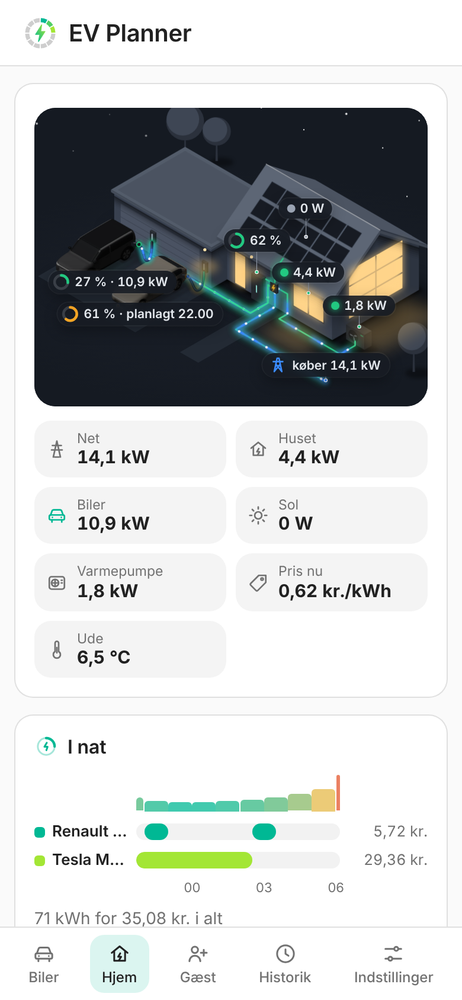
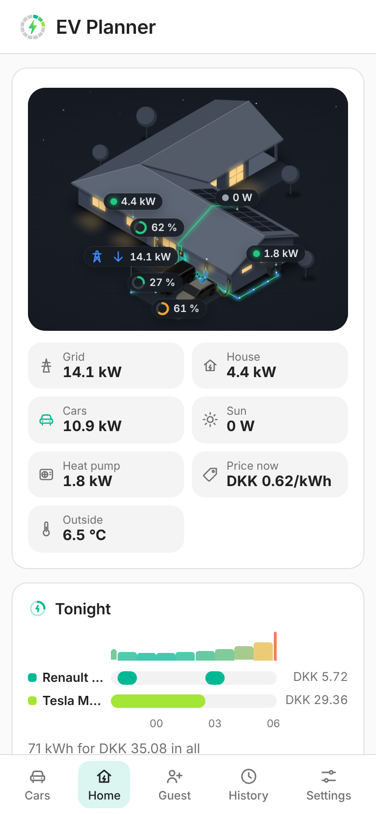

<p align="center">
  <picture>
    <source media="(prefers-color-scheme: dark)" srcset="docs/images/logo-dark.png">
    
  </picture>
</p>

<p align="center">
  <a href="https://github.com/Dinnsen/ha-ev-planner/releases"></a>
  <a href="https://github.com/Dinnsen/ha-ev-planner/releases"></a>
  <a href="https://my.home-assistant.io/redirect/marketplace_repository/?owner=Dinnsen&repository=ha-ev-planner&category=integration"></a>
  
  <a href="https://github.com/Dinnsen/ha-ev-planner/actions/workflows/tests.yml"></a>
  <a href="LICENSE"></a>
  <a href="https://buymeacoffee.com/dinnsen"></a>
</p>

# EV Planner til Home Assistant

🇬🇧 [Read in English](README.md)

EV Planner lader husstandens elbiler, når strømmen er billigst, og tager sig stadig af gæsten, der kommer i elbil. Den læser elpriserne, hver bils batteriniveau og ladegrænse, og hvornår bilen skal være klar, og planlægger den billigste ladning. Derefter starter og pauser den ladningen via bilen eller laderen – eller, for en bil ingen af dem kan styre, planlægger den, minder dig om stikket og fortæller, hvad der sker.

EV Planner er bygget på [EV Guest](https://github.com/Dinnsen/EV-Guest) (planlæggeren, prisuret og gæsteflowet) og kan alt det, [EV Smart Charging](https://github.com/jonasbkarlsson/ev_smart_charging) kan, og mere til.

## Funktioner

- **Så mange biler og ladepunkter, I har.** Biler og ladepunkter tilføjes på integrationens side. Biler på samme ladepunkt deler det: den, der skal være klar først, får det først, og en gæst har det under gæstesessionen.
- **I vælger per bil, hvem der starter og stopper ladningen:** bilen (dens ladekontakt), laderen (dens kontakt) eller ingen – så planlægger EV Planner, minder jer om stikket og udsender en *Ladestyring*-sensor til egne automationer.
- **Den billigste plan** ud fra kvarter- eller timepriser: i hele kvarterer (som EV Smart Charging), én periode eller de billigste perioder, med pris og besparelse. Bilen stopper selv ved sin grænse, så det kvarter, den ikke bruger helt, koster ingenting.
- **Lærer hvor hurtigt hver bil lader.** Planen regnes ud fra den ladehastighed i % pr. time, bilen selv viser. En bil, der trækker mindre end indstillet, eller et batteri, der ikke har den størrelse, I troede, får stadig en plan, der er lang nok. Intet at indstille: ingen effektivitet, intet gætteri. En ladning tæller, når niveauet er steget mindst 30 %, og under ladningen følger planen den hastighed, bilen viser. Med bilens sensor for ladeeffekt lærer EV Planner også effekten og tæller energien med den.
- **Klar kl.** et tidspunkt, per ugedag (gerne med sit eget mål, fx fredag 100 %), eller efter en tur i kalenderen ("Elroq 7:15 80% klima 21,5": klar kl. 7.15 med 80 %, bilen varmet op til 21,5° – se [Ture fra en kalender](#ture-fra-en-kalender)).
- **Afgange** på bilens side: en rulleliste med *Morgen*, *Middag*, *Aften*, *I morgen eftermiddag*, *Weekend* (kun til de billigste priser, klar mandag morgen), *Ferie* (kun de billigste timer, klar den dag I er hjemme) og jeres egne – én gang, derefter ugeplanen igen. Listen er husstandens, under *Indstillinger → Afgange*.
- **Bilens klima:** en knap på bilens side, og af sig selv før en kalendertur eller en afgang, når det er koldt (slås til). Klimaet findes selv på bilens enhed.
- **Lærer bilens ladekurve:** mange biler lader langsommere til sidst, så hastigheden læres i hvert bånd af ladeniveauet (0–50, 50–80, 80–90, 90–100 %), og en plan til 100 % giver de sidste procent den tid, de tager. En morgen, hvor bilen ikke helt nåede det, får de næste planer til at slutte lidt før (i kvarterer, højst en time); tre morgener til tiden flytter det tilbage.
- **Hellere tidligt:** den plan, der er færdig først, når den højst koster et par øre mere pr. kWh end den billigste – næsten ens priser skubber ikke ladningen langt ud på natten.
- **Top op før afgang:** lad fx til 80 % når det er billigst og resten lige før klar-tiden, så bilen ikke står på 100 % hele natten.
- **En plan, der ikke flytter sig for få øre:** en ny pris eller måling beholder planen, medmindre en ny sparer mere end 0,50 kr. (eller 2 %).
- **Regler fra EV Smart Charging:** minimumsniveau uanset pris, prisloft (fast pris, eller gennemsnittet frem til klar-tiden plus en procent), lad ved lav pris, lad ved lavt batteri, opportunistisk ladning, tidligste start og hold laderen tændt (forvarmning fra nettet).
- **Lad færdig i ét stræk:** Når det højst koster et valgt beløb mere pr. kWh (fx 0,05 kr.) at lade videre nu eller i én periode end den billigste plan, lader bilen færdig i ét stræk i stedet for at stoppe ved daggry og lade det sidste næste nat for et par øre mindre. En anden bil, der er sat til samme lader, beholder de timer, den har planlagt. En bil uden stik holder ingen timer fri, for på en lader med ét kabel er det bilen, der er sat til, der lader i sin plan.
- **Tilstande:** Smart, Lad nu (tilbage til Smart, når bilen er fuld eller taget ud), Pause, Fra.
- **Tjekker at ladningen startede:** prøver igen efter 6 og 12 minutter, giver så besked og prøver af og til igen. Højst 12 kommandoer pr. bil i timen. En bil, der ikke starter igen efter en pause i planen (nogle biler skal have stikket sat i igen), bliver lært og lader så i ét stræk.
- **Klar uden priser:** mens den venter på priser, har en bil med klar-tid en plan, der slutter lige før, hvis priserne aldrig kommer. Rigtige priser erstatter den.
- **Påmindelse om stikket** med knapperne *Lad nu* og *Følg planen*, **live-notifikationer** mens bilen lader (Live Activities på iPhone, Live Updates på Android), **besked når bilen er ladet** og en **morgenkvittering** ved klar-tiden med en advarsel, hvis bilen ikke kan nå målet – alle med ikoner. Alt om beskeder ligger i panelet under *Indstillinger → Beskeder*: øverst det, der gælder alle biler (til/fra, stille timer, telefoner, sprog), og nedenunder hver bils egne.
- **Gæstebilen** præcis som i EV Guest: opslag på nummerplade, prisur, regning og historik – og *Lad nu*, der lader med det samme og gemmes i historikken. En plan i to perioder kommer med på regningen for begge, og en ny plan, mens gæsten lader, beholder det, der allerede er ladet.
- **Historik pr. tilkobling:** med en stik-sensor kommer en ladning i historikken, når bilen tages ud – én linje med dens perioder, ikke én pr. pause.
- **Billeder** af jeres biler og ladere (tryk på billedet i panelet), og tegninger af ca. 40 kendte ladere.
- **Statistik:** energi, pris og ladninger per bil og måned.
- **Steder:** hjemmet og et sommerhus med egne ladere. En bil, der bruger flere ladere, findes ved den, den er sat til, på sin placering, stikkene og ladernes effekt, og I bliver spurgt, når det ikke kan afgøres.
- **Fælles forsyning:** flere biler bag én sikring planlægges sammen under en grænse pr. fase, i kø eller efter behov, med en *vagt*, der skruer bilerne ned inden for minuttet, når måleren viser, at huset skal bruge mere.
- **Solen og husbatteriet:** en bil kan lade på overskuddet, ampere for ampere, med husbatteriet først; overskuddet sælges i stedet, når det betaler sig bedre end natten.
- **Kendte priser eller prognosen:** en plan til en klar-tid flere dage ude kan bruge prisprognosen eller kun de offentliggjorte priser, med hvad det andet ville koste på knappen.
- **Panel** i sidebjælken og som app på hjemmeskærmen, på dansk og engelsk, lyst og mørkt. Bilens side viser med ét blik, hvornår den er klar, til hvad, for hvor meget og hvornår den lader, og *hvorfor* den gør det, den gør nu; prisgrafen viser, hvornår den faktisk ladede. *Enkel*, *Smart* og *Ekspert* viser færre eller flere valg.
- **Priser fra** Energi Data Service, Nord Pool, ENTSO-e, GE-Spot eller enhver sensor med en liste af priser med start og pris.

## Installation

[](https://my.home-assistant.io/redirect/marketplace_repository/?owner=Dinnsen&repository=ha-ev-planner&category=integration)

1. **Indstillinger → Marketplace**, søg efter **EV Planner**, og installér den (eller brug knappen ovenfor).
2. Genstart Home Assistant, hvis den beder om det.

Før Home Assistant 2026.11 hed Marketplace HACS: søg efter **EV Planner** der, og hent den.

### Opdatering fra EV Planner 1.x

Fra version 2.0 er EV Planners domæne `ev_household_planner` (før `ev_planner`, som en anden integration i Marketplace bruger). Navnet, panelet, kortene og entitets-id'erne er de samme.

1. Opdatér EV Planner i Marketplace, og genstart Home Assistant. EV Planner 1.x kører videre indtil næste trin.
2. **Indstillinger → Enheder og tjenester → Tilføj integration → EV Planner.** EV Planner tilbyder at flytte husstanden fra 1.x: opsætning, biler, ladepunkter, indstillinger, planer, historik, læring og billeder, og entiteterne med deres entitets-id'er, så dashboards og automationer, der bruger dem, virker som før.
3. Slet mappen `config/custom_components/ev_planner`, og genstart Home Assistant. En reparation minder dig om det, så længe den ligger der.

Handlingerne hedder nu `ev_household_planner.*` i stedet for `ev_planner.*`: ret automationer og scripts, der bruger dem.

## Opsætning

1. **Indstillinger → Enheder og tjenester → Tilføj integration → EV Planner.** Vælg prissensor og valuta. MotorAPI-nøglen bruges kun til gæstebiler. Uden for Danmark: vælg *Andet land* – så indtastes gæstens batteri og ladeeffekt i hånden.
2. **Tilføj ladepunkt** for hvert ladepunkt. Vælg laderens enhed i Home Assistant og/eller mærke og model, så udfylder EV Planner effekt, kontakt, energimåler og *bil tilsluttet*-sensor, som I kan rette.
3. **Tilføj bil** for hver bil (alle biler sættes op ens). Vælg bilens enhed i Home Assistant, så finder EV Planner ladeniveau, ladegrænse, stik, ladning, placering og ladekontakt: batterikapacitet (et tal eller en sensor fra bilen), bilens sensorer (alle valgfri, også ladeeffekt i kW), ladeeffekt (et udgangspunkt, indtil bilen har vist den), ladepunkt, og hvem der starter og stopper ladningen. Har I EV Smart Charging, kan I starte fra den bil derfra – også med dens ladehastighed i % pr. time.
4. **Konfigurer**: valutaen. Telefoner, et beløb der lægges til hver pris, og iOS-widgets sættes i panelet under *Indstillinger*. Bilens klima findes selv på bilens enhed (et andet vælges under *Regler → Klima*), og kalenderne er husstandens, under *Indstillinger → Kalender*.
5. Valgfrit, på samme side: **Tilføj solceller**, **Tilføj husbatteri** og **Tilføj varmepumpe**, og **Tilføj sted** til et sommerhus. Hjemmet er stedet *Hjem*, som laves af sig selv; åbn det for fælles forsyning (grænsen, faserne og en måler). Med mere end ét sted har hver lader et *Sted*.

## Fra EV Smart Charging

Når I tilføjer en bil, kan I starte fra en bil i EV Smart Charging: sensorer, ladekontakt og indstillinger kopieres. EV Smart Charging ændres ikke. Kør begge en tid med *ingen* styring i EV Planner, sammenlign planerne, og slå så styringen til i EV Planner og *Smart charging activated* fra i EV Smart Charging.

## Kort til dashboards


EV Planner har seks kort til jeres egne dashboards. De følger med integrationen – der skal ikke tilføjes en ressource eller installeres andet – og findes under **Tilføj kort** (søg på *EV Planner*), med en visuel editor, hvor I vælger bil eller lader. De bruger panelets egen tegning, så de ser ud og opdateres præcis som det.

| Kort | | Bredde |
| --- | --- | --- |
| **Husstand** `custom:ev-planner-household-card` | Alle biler, gæsten og laderne på én linje med ladeniveau og status. Til en forside med lidt plads. | Hel |
| **Bil** `custom:ev-planner-car-card` | En bil: batteri, mål, hvornår den lader, pris og besparelse. | Halv |
| **Bil, stor** `custom:ev-planner-car-large-card` | Bilkortet fra EV Planners oversigt: lille prisur, batteri og tilstandsknapperne, som virker direkte på kortet. | Hel |
| **Gæst** `custom:ev-planner-guest-card` | *Tilføj gæst*, når der ingen er, ellers nummerplade, bil, plan og pris – med *Stop ladning*, mens den lader, og *Afregn*, når den er færdig. | Halv |
| **Lader** `custom:ev-planner-charger-card` | En lader: hvad den gør, for hvem, og hvem der er den næste. | Halv |
| **Bubble** `custom:ev-planner-bubble-card` | En bil, gæsten eller en lader som én [Bubble Card](https://github.com/Clooos/Bubble-Card)-knap, der passer ind mellem jeres Bubble-kort. Se nedenfor. | Én række |

**Tryk på et kort** åbner en pop-up med bilens, gæstens eller laderens side: prisuret, batteriet med håndtag, klar kl., ugeplanen og plantypen for en bil; det hele for gæsten; og bilerne på en lader, som man kan trykke videre på. Regler og beskeder ligger i EV Planner – pop-up'ens **Åbn i EV Planner** går dertil. Pop-up'en er Home Assistants egen dialog, så den ligger over alt andet (også inde i en Bubble Card pop-up) og lukkes med tilbage-knappen eller ved at trække den ned på telefonen.

```yaml
type: custom:ev-planner-car-card
vehicle: 01M59TAC12D9P50SH4HK4RN1JA   # editoren udfylder den
name: Tesla                           # valgfrit
tap_action: popup                     # popup (standard), panel eller none
```

`tap_action: panel` åbner EV Planner direkte på bilen, laderen eller gæsten i stedet for pop-up'en. Husstandskortet har `show_cars`, `show_guest` og `show_chargers` (alle `true` som standard). Panelets sider har hver sin adresse: `/ev-planner/car/<id>`, `/ev-planner/charger/<id>`, `/ev-planner/guest`, `/ev-planner/history` og `/ev-planner/settings`.

### Bubble-kortet


Bubble-kortet har Bubble Cards mål (én række på 50 px, rundt ikon, navn og status, sub-knapper til højre) og læser de samme `--bubble-*`-variabler, så et tema, der styler Bubble Card, også styler det. Bubble Card behøver ikke at være installeret.

- **En bil:** ladeniveauet fylder knappen som en Bubble-slider, en tynd streg viser målet, og der løber et lys gennem fyldet, mens den lader. Sub-knapperne er planens pris og tilstanden, som åbner en menu med *Smart*, *Lad nu*, *Pause* og *Fra*.
- **Gæsten:** *Tilføj*, når der ingen er; ellers nummerplade, bil, status og niveauer – med *Stop*, mens den lader, og *Afregn*, når den er færdig.
- **En lader:** hvem den lader for, eller hvem der er den næste, og effekten, mens den lader – så er hele knappen fyldt, som en Bubble-kontakt, der er tændt.

```yaml
type: custom:ev-planner-bubble-card
vehicle: 01M59TAC12D9P50SH4HK4RN1JA   # eller charger: <id>, eller guest: true
```

### Temaer

Kortene følger jeres tema uden card-mod: Home Assistants egne variabler for kort og dialoger, Bubble Cards `--bubble-*`-variabler for Bubble-kortet, menuen og pop-up'en, og [Theme Studio](https://github.com/Dinnsen/theme-studio)s glas-slør, hævede flade, chip-hjørner og pop-up-kant og -skygge. Den [engelske README](README.md#themes) har den fulde liste.

## Panelet

**EV Planner** i sidemenuen har fem faner: **Biler** (et kort pr. bil; tryk for bilens side med *Nu*, *Regler* og *Historik*), **Hjem** (huset som lermodel med biler, ladere, sol, batteri og varmepumpe, dag og nat), **Gæst**, **Historik** (dag, uge, måned og år, og *Eksportér CSV* med én linje pr. opladning) og **Indstillinger**.

Under *Indstillinger → Hus* vælger I billedet i Hjem-fanen: det *klassiske* hus, *vinkelhuset* (et vinkelhus set med garagen nærmest) eller et af otte andre: længehus, T-hus, H-hus, funkis, træsommerhus, valmet parcelhus, halvandet plan og rækkehus. Med mere end ét sted har hvert sted sit eget hus, og Hjem-fanen har en knap for hvert sted. En administrator kan trykke *Tilpas* på billedet og flytte laderne, elboksen, husbatteriet og varmepumpen, tegne ledningernes vej, sætte solceller op eller tage dem ned på tagene og flytte mærkaterne, så de ikke er i vejen. Det gemmes for hvert hus og ser ens ud på alle enheder.

 

## Priser

EV Planner læser priserne fra én prissensor. Viser den spotprisen uden tariffer og afgifter, så sæt *Lægges til hver pris* i panelet under *Indstillinger → Afregning med gæster*: et beløb pr. kWh, der lægges til hver time. Med solceller kan I angive, hvad I får for en solgt kWh, som tal eller sensor (under stedets solceller): opladningens kWh fra solen regnes så til den pris i stedet for som gratis.

## Fælles forsyning, sol og varmepumpe

Flere biler bag én sikring: på stedet (integrationen, *Hjem*) under *Fælles forsyning* sættes det, huset højst må trække pr. fase, faserne og en måler. Bilerne planlægges så sammen under grænsen, billigste timer først, og *vagten* skruer bilerne ned med det samme, når huset skal bruge mere. Vagten slås til i panelet under *Indstillinger → Steder*, med hvor længe den venter efter en spids (5–30 minutter). En måler, der ikke har meldt sig i fem minutter, stoles der ikke på: bilerne går til mindste strøm. Med en vejr-entitet regner EV Planner med nattens temperatur, og en varmepumpe kan holdes tilbage i højst 15 minutter, før en bil stoppes. Vagten er ikke en sikring; behold laderens egen lastbalancering.

Med solceller (**Tilføj solceller** under integrationen, på stedet: en sensor for strømmen til og fra nettet, solcellernes effekt og salgsprisen) kan en bil lade på overskuddet fra solen: *Sol og plan* eller *Kun sol*. Når en kWh sælges for mere, end bilens plan betaler for en, lader en bil på *Sol og plan* overskuddet gå til nettet og lader i sine billige timer i stedet; salgsprisen sættes under stedets solceller.

## Flere ladere og et sommerhus

**Bilen finder selv sin lader.** Vælg *Findes hver gang* som bilens lader, når den bruger flere. Når en lader får en bil, finder EV Planner ud af hvilken: den bil, der er på laderens sted, siger den er tilsluttet, og ikke holder ved en anden lader. Det kræver laderens *Bil tilsluttet* og bilens *Tilsluttet* og *Hjemme*.

- **En bil, der melder sig langsomt** (mange bilers sky spørger kun bilen hvert tiende minut): giv bilen en *Spørg bilen nu*-entitet, en knap eller et script, der får integrationen til at spørge bilen med det samme. Den bruges, når en lader har en bil, ingen har sagt hvilken, højst to gange for én tilslutning.
- **To biler, det kan være:** laderens *Effekt nu* skiller dem ad, når den ene lader.
- **Når det ikke kan afgøres,** får I et spørgsmål på telefonerne efter fem minutter (tolv, når ingen bil kunne spørges): hvilken bil, eller en gæst. Indtil da står laderen som *Ukendt bil* og bliver ladt i fred. I kan også svare på laderens side i panelet og rette det, EV Planner fandt.
- **En lader uden sensor for tilsluttet bil** er bilens lader, når den er den eneste af slagsen på stedet.
- En bil med sin egen lader beholder den. Intet ændrer sig, hvor hver bil har sin lader.

**Steder.** Hjemmet er et sted (*Hjem*), og et sted med ladere ud over det, fx et sommerhus, tilføjes under integrationen (*Tilføj sted*): dets zone i Home Assistant, dets egen grænse og måler, hvis I vil, og dets egen prissensor, hvis det ligger i et andet prisområde (et sommerhus i DK1, når hjemmet er i DK2): en bil der planlægges så med stedets priser. Solceller, husbatteri og varmepumpe er dele for sig, som tilføjes på samme måde og hører til et sted. Vælg stedet i hver laders indstillinger (feltet er der, når der er mere end ét sted). Bilen er på stedet, når dens placering viser zonen; den planlægges da på stedets forsyning. Hvert sted har sit eget billede og hus i Hjem-fanen.

**Laderen starter og stopper, bilen er backup.** En ny bil styres af laderen, når laderne har en kontakt, for en lader er oftere til at få fat i end en bil. Med *Den anden er backup* træder bilens egen kontakt til, når laderen ikke svarer (og omvendt). Det, der satte bilen på pause, starter den også igen.

**Peblar (også de ladere, Peblar bygger for OK), Zaptec og andre.** Vælg laderens enhed, så udfyldes kontakt, strømgrænse, effekt, energimåler og status. Peblars lokale API skal være slået til, for at Home Assistant kan se laderen; uden det har laderen ingen entiteter, og bilens egen kontakt styrer opladningen. Peblar tåler tre pauser på ti minutter, så EV Planner venter med en start, når næste pause ville være én for meget; Zaptecs strøm sættes højst op hvert 15. minut (ned med det samme).

**Deling efter behov.** Under *Indstillinger → Steder* kan *Når der ikke er plads til alle* sættes til *Efter behov*: når der ikke er plads til alle bilerne i en time, deles de om den efter de kWh, hver mangler, aldrig under 6 A til hver.

## Reglerne og deres tider

Hvad EV Planner gør af sig selv, og hvor længe den venter. Ingen af dem er indstillinger: de er valgt, så sikringen holder, laderens sky ikke slides, og en drivende sky ikke starter og stopper en bil.

**Bilerne og den fælles forsyning**

| Hvad | Regel |
|---|---|
| Måleren | Alle faser vælges; den hårdest belastede tæller. En måler, der ikke har meldt i 5 minutter, stoles der ikke på: bilerne sættes til den mindste strøm, til den er tilbage. |
| Grænsen | Det, I sætter pr. fase (fx 23 A på en 25 A sikring). Planen holder huset og bilerne under den time for time. |
| Den mindste strøm | 6 A for en bil med strømindstilling. En bil får aldrig mindre: den venter i stedet. |
| Deling af en time uden plads til alle | *I kø*: bilen, der skal være klar først, tager, hvad den skal bruge. *Efter behov*: efter de kWh, hver mangler, aldrig under 6 A; bruges kun, når ingen bil stilles dårligere. |
| Ned (vagten) | Med det samme, når måleren er over grænsen, bilen bagerst i køen først. Derefter holdes varmepumpen tilbage (hvis valgt), og til sidst pauses en bil. Måleren ses efter igen hvert minut. |
| En nedskruning tæller som sket i | 60 sekunder, mens laderen og måleren følger med. |
| Op igen efter en nedskruning | Tidligst 2 minutter efter, at vagten satte bilen ned. |
| Op, hvor tit | Højst hvert 5. minut. **Zaptec: højst hvert 15. minut**, som Zaptec beder om. Ændringer under 1 A sendes ikke. |
| Op, hvor langt | Til det, måleren viser er ledigt nu, minus 1 A, i ét trin; aldrig mere, end planen gav bilen. |
| En bil, vagten pausede | Venter mindst 5 minutter, og derefter til måleren viser plads til den. |
| Varmepumpen holdt tilbage | 15 minutter ad gangen, højst to gange på en nat. |
| Easee | Easees egen dynamiske grænse med 30 minutters udløb, fornyet hvert 15. minut: laderen falder selv tilbage, hvis Home Assistant stopper. |

**Solen**

| Hvad | Regel |
|---|---|
| Start på solen | Når der har været nok til 6 A i 1 minut. |
| Stop | Når der har været for lidt i 4 minutter. |
| Ned | Med det samme, når huset ellers ville købe. |
| Op | Når der har været plads i 2 minutter, højst hvert 5. minut (**Zaptec: 15**), og kun til det, solen har givet det meste af de seneste 10 minutter. |
| En eller tre faser | Skiftes højst hvert 15. minut. |
| Holdes tilbage | 0,1 kW, så huset ikke køber til bilen med en lille margin. |
| Prognosen | Planen regner højst med halvdelen af den sol, prognosen lover før klar-tiden. |

**Start og pause**

| Hvad | Regel |
|---|---|
| En start eller pause tjekkes | Efter 6 minutter, og prøves igen; en bil, der stadig ikke følger, vises som et problem, og I får besked. |
| Kommandoer | Højst 12 pr. bil i timen, og ikke den samme to gange inden for 60 sekunder. |
| Pauser | Højst 3 på 10 minutter for en lader, der tager det ilde op (Peblar): en start venter, når den næste pause ville være én for meget. |
| En bil, der lige er sat til | Mange biler starter af sig selv: i 3 minutter sendes pausen igen, hvis bilen lader alligevel. |
| At finde laderen | På bilens position, stikkene og laderens effekt. Stadig i tvivl efter 5 minutter (12 for en bil, der melder langsomt): mobilerne spørges, og laderen lades være indtil da. |
| Hold laderen tændt | Kun når bilen selv stopper ved målet: målet er 100 %, eller bilens egen grænse er målet. |

## Sådan passer den på bilen

- Højst tolv kommandoer i timen til en bil eller lader; den sidste er gemt til et stop.
- Efter en pause hviler bilen to minutter, før den startes igen (ikke når I selv beder om det).
- Når en kommando fejler, venter næste forsøg længere og længere (1, 2, 5, 10 og 15 minutter), og efter tre fejl i træk kommer der en reparation i Home Assistant, som forsvinder af sig selv, når det virker igen. Et stop fra vagten sendes altid med det samme.
- Det, EV Planner holder tilbage (varmepumpe, laderens strøm, faser), huskes over en genstart og slippes igen.

## Ture fra en kalender

Vælg jeres kalendere under *Indstillinger → Kalender* i panelet: alle kalendere i Home Assistant – Google, Outlook/Office 365, iCloud (CalDAV), en lokal kalender – så mange I vil. EV Planner læser de næste 36 timer hvert kvarter.

**Hvor:** skriv i begivenhedens **titel** eller **beskrivelse**, med bilens **ord**: det første ord i dens navn (`Tesla`, `Elroq`), medmindre du vælger et andet under *Indstillinger → Kalender*. Begivenheder uden ordet er ikke bilens – så en fælles familiekalender virker. Ordet `*` gør alle begivenheder til bilens.

**Den korte måde:** `Elroq 7:15 80% klima 21,5` – klar kl. 7.15 med 80 %, og bilen varmet op til 21,5°. Hver del kan undværes, i vilkårlig rækkefølge:

| Du skriver | Det betyder |
| --- | --- |
| *(ingenting)* | Bilen skal være klar ved begivenhedens start. |
| `7:15` eller `7.15` | Klar kl. 7.15 på begivenhedens dag i stedet (møde kl. 9, afgang 7.15). Virker også i en heldagsbegivenhed. |
| `80%` | Lad til 80 % til denne tur (10–100). `fuld` er 100 %. |
| `klima` | Varm (eller køl) bilen inden afgang, til temperaturen under *Regler → Klima*. `forvarm`, `climate` og `preheat` virker også. |
| `klima 21,5` | … til 21,5° (afrundet til bilens egne trin, fx halve grader fra 16 til 29,5). |

**Eksempler:**

- `Elroq Aarhus 90%` kl. 06.00 – klar kl. 06.00 med 90 %.
- `Møde Odense – Elroq 7:15 fuld klima 21` kl. 09.00 – klar kl. 07.15 med 100 %, og bilen varmet op til 21° fra kl. 07.00.
- En heldagsbegivenhed `Elroq 6:30 80%` – klar kl. 06.30 den dag med 80 %.

**Godt at vide:** en heldagsbegivenhed uden klokkeslæt ignoreres. Turen går før ugeplanen og et forvalg, når den kommer først. Klimaet starter *Før afgang* minutter før (standard 15) og én gang pr. tur; ordet i kalenderen starter det uanset vejret, mens det automatiske klima (*Regler → Klima*) kræver, at det er koldt, og – medmindre du slår det fra – at bilen er sat i. Kalenderen ændrer ikke bilens temperatur fast – kun til den start.

## Afgange og klima

**Afgange** på bilens side sætter en klar-tid én gang; når den er gået, bruges ugeplanen igen. Listen er husstandens, under *Indstillinger → Afgange* i panelet, og alle biler har den. Hver afgang har et navn, en dag (*Næste gang*, *I dag*, *I morgen* eller en ugedag), et klokkeslæt, hvor billigt den lader, og evt. sit eget mål:

- **Billigst før afgang** (standard): som enhver klar-tid.
- **Kun laveste pris**: kun når prisen højst er X % over den laveste kendte pris (*Weekend*: 10 %, klar mandag morgen).
- **Kun billigste timer**: kun i de billigste X % af timerne frem til afgang (*Ferie*: 10 %).

Ret, slet, flyt eller lav jeres egne (*I morgen eftermiddag 17.00*, *Fodbold lørdag 9.30*). *Ugeplan* og *Ferie* er der altid; *Ferie* spørger om dagen, I er hjemme. Minimumsniveauet gælder stadig, og en kalendertur, der kommer først, vinder stadig. Handlingen `ev_household_planner.set_trip` tager en afgangs id, eller `week`.

**Klimaet:** bilens klima findes på dens enhed (en Teslas eller Skodas klima-entitet); et andet kan vælges under *Regler → Klima*, også en kontakt, knap eller et script, der starter det. Bilens side har så en klima-knap. En klima-entitet sættes til sin varmetilstand (fx *heat_cool*) og temperaturen under *Regler → Klima*; en kontakt, knap eller et script startes bare. Under *Regler → Klima* starter *Start klima af sig selv* det før en kalendertur eller en afgang, når vejret ved stedet siger, at det er koldere end din grænse (standard 5°), og som standard kun mens bilen er sat i, så det kører på nettet.

## Kendte begrænsninger

- En bil uden styring bliver kun planlagt: den lader, når den er sat til, medmindre bilen selv venter.
- Morgendagens priser kommer som regel først på eftermiddagen; indtil da viser en plan til i morgen tidlig *Venter på priser*, eller bygger på prisprognosen, hvis prissensoren har en.
- To biler på ét ladepunkt uden *tilsluttet*-sensorer kan ikke skelnes; begge planlægges. Med *Findes hver gang* spørger EV Planner på telefonerne i stedet.
- En bil, der kun kan pauses med en ladegrænse (fx en Mercedes sat op med *max state of charge*), kan ikke pauses under den laveste grænse, bilen tager, ofte 50 %.
- Vagten reagerer inden for et minut, ikke i millisekunder, og er ikke en sikring: behold laderens egen lastbalancering.
- Nummerpladeopslag er dansk (MotorAPI). Uden for Danmark indtastes gæstens batteri og ladeeffekt i hånden.

## Fejlfinding

- **Ingen plan:** se `sensor.<bil>_status` og dens attributter. *Venter på priser* er normalt, før morgendagens priser kommer.
- **Bilen starter ikke:** `binary_sensor.<bil>_charging_problem` og attributten `control_error` siger hvorfor.
- **Hent diagnostik** fra integrationens side til en fejlrapport; nummerplade og API-nøgle er fjernet.

## Widgets

En integration kan ikke selv lægge widgets på telefonen, men companion-appens widgets kan vise EV Planner: på iOS fx et *Brugerdefineret*-, *Gauge*- eller *Sensorer*-widget med `sensor.<bil>_summary`, `sensor.<bil>_status` og bilens batteri. Slå **Opdater iOS-widgets** til i panelet under *Indstillinger → App på hjemmeskærmen*.

## Fjern integrationen

Fjern EV Planner under **Indstillinger → Enheder og tjenester**. Indstillinger, planer og historik slettes med den. Bilerne og ladepunkterne ændres ikke.

## Tak til

[EV Smart Charging](https://github.com/jonasbkarlsson/ev_smart_charging) af Jonas Karlsson, som viste vejen for prisstyret opladning i Home Assistant. Flere af reglerne og *Fra EV Smart Charging* bygger på dens idéer.

Se den [engelske README](README.md) for entiteter, handlinger og kendte begrænsninger.
