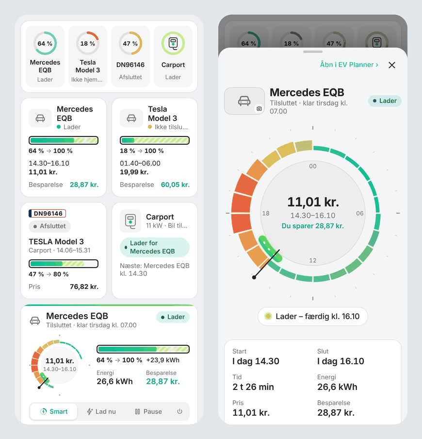
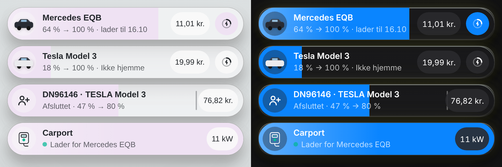

<p align="center">
  <picture>
    <source media="(prefers-color-scheme: dark)" srcset="docs/images/logo-dark.png">
    
  </picture>
</p>

# EV Planner til Home Assistant

🇬🇧 [Read in English](README.md)

EV Planner lader husstandens elbiler, når strømmen er billigst, og tager sig stadig af gæsten, der kommer i elbil. Den læser elpriserne, hver bils batteriniveau og ladegrænse, og hvornår bilen skal være klar, og planlægger den billigste ladning. Derefter starter og pauser den ladningen via bilen eller laderen – eller, for en bil ingen af dem kan styre, planlægger den, minder dig om stikket og fortæller, hvad der sker.

EV Planner er bygget på [EV Guest](https://github.com/Dinnsen/EV-Guest) (planlæggeren, prisuret og gæsteflowet) og kan alt det, [EV Smart Charging](https://github.com/jonasbkarlsson/ev_smart_charging) kan, og mere til.

## Funktioner

- **Så mange biler og ladepunkter, I har.** Biler og ladepunkter tilføjes på integrationens side. Biler på samme ladepunkt deler det: den, der skal være klar først, får det først, og en gæst har det under gæstesessionen.
- **I vælger per bil, hvem der starter og stopper ladningen:** bilen (dens ladekontakt), laderen (dens kontakt) eller ingen – så planlægger EV Planner, minder jer om stikket og udsender en *Ladestyring*-sensor til egne automationer.
- **Den billigste plan** ud fra kvarter- eller timepriser: i hele kvarterer (som EV Smart Charging), én periode eller de billigste perioder, med pris og besparelse. Bilen stopper selv ved sin grænse, så det kvarter, den ikke bruger helt, koster ingenting.
- **Lærer hvor hurtigt hver bil lader.** Planen regnes ud fra den ladehastighed i % pr. time, bilen selv viser. En bil, der trækker mindre end indstillet, eller et batteri, der ikke har den størrelse, I troede, får stadig en plan, der er lang nok. Intet at indstille: ingen effektivitet, intet gætteri. En ladning tæller, når niveauet er steget mindst 30 %, og under ladningen følger planen den hastighed, bilen viser. Med bilens sensor for ladeeffekt lærer EV Planner også effekten og tæller energien med den.
- **Klar kl.** et tidspunkt, per ugedag, eller efter en tur i kalenderen ("Aarhus 90 %" lader til 90 %).
- **Regler fra EV Smart Charging:** minimumsniveau uanset pris, prisloft, lad ved lav pris, lad ved lavt batteri, opportunistisk ladning, tidligste start og hold laderen tændt (forvarmning fra nettet).
- **Lad færdig i ét stræk:** Når det højst koster et valgt beløb mere pr. kWh (fx 0,05 kr.) at lade videre nu eller i én periode end den billigste plan, lader bilen færdig i ét stræk i stedet for at stoppe ved daggry og lade det sidste næste nat for et par øre mindre. En anden bil, der er sat til samme lader, beholder de timer, den har planlagt. En bil uden stik holder ingen timer fri, for på en lader med ét kabel er det bilen, der er sat til, der lader i sin plan.
- **Tilstande:** Smart, Lad nu (tilbage til Smart, når bilen er fuld eller taget ud), Pause, Fra.
- **Tjekker at ladningen startede:** prøver én gang til og giver så besked.
- **Påmindelse om stikket** med knapperne *Lad nu* og *Følg planen*, **live-notifikationer** mens bilen lader (Live Activities på iPhone, Live Updates på Android) og **besked når bilen er ladet** – alle med ikoner.
- **Gæstebilen** præcis som i EV Guest: opslag på nummerplade, prisur, regning og historik – og *Lad nu*, der lader med det samme og gemmes i historikken.
- **Billeder** af jeres biler og ladere (tryk på billedet i panelet), og tegninger af ca. 40 kendte ladere.
- **Statistik:** energi, pris og ladninger per bil og måned.
- **Panel** i sidebjælken og som app på hjemmeskærmen, på dansk og engelsk, lyst og mørkt.

## Installation

Tilføj `https://github.com/Dinnsen/ha-ev-planner` som brugerdefineret repository i HACS (type **Integration**), hent **EV Planner** og genstart Home Assistant.

## Opsætning

1. **Indstillinger → Enheder og tjenester → Tilføj integration → EV Planner.** Vælg prissensor og valuta. MotorAPI-nøglen bruges kun til gæstebiler.
2. **Tilføj ladepunkt** for hvert ladepunkt. Vælg laderens enhed i Home Assistant og/eller mærke og model, så udfylder EV Planner effekt, kontakt, energimåler og *bil tilsluttet*-sensor, som I kan rette.
3. **Tilføj bil** for hver bil (alle biler sættes op ens): batterikapacitet (et tal eller en sensor fra bilen), bilens sensorer (alle valgfri, også ladeeffekt i kW), ladeeffekt (et udgangspunkt, indtil bilen har vist den), ladepunkt, og hvem der starter og stopper ladningen. Har I EV Smart Charging, kan I starte fra den bil derfra – også med dens ladehastighed i % pr. time.
4. **Konfigurer**: hvilke mobiler der får beskeder, og om iOS-widgets skal opdateres.

## Fra EV Smart Charging

Når I tilføjer en bil, kan I starte fra en bil i EV Smart Charging: sensorer, ladekontakt og indstillinger kopieres. EV Smart Charging ændres ikke. Kør begge en tid med *ingen* styring i EV Planner, sammenlign planerne, og slå så styringen til i EV Planner og *Smart charging activated* fra i EV Smart Charging.

## Kort til dashboards



EV Planner har seks kort til jeres egne dashboards. De følger med integrationen – der skal ikke tilføjes en ressource eller installeres noget i HACS – og findes under **Tilføj kort** (søg på *EV Planner*), med en visuel editor, hvor I vælger bil eller lader. De bruger panelets egen tegning, så de ser ud og opdateres præcis som det.

| Kort | | Bredde |
| --- | --- | --- |
| **Husstand** `custom:ev-planner-household-card` | Alle biler, gæsten og laderne på én linje med ladeniveau og status. Til en forside med lidt plads. | Hel |
| **Bil** `custom:ev-planner-car-card` | En bil: batteri, mål, hvornår den lader, pris og besparelse. | Halv |
| **Bil, stor** `custom:ev-planner-car-large-card` | Bilkortet fra EV Planners oversigt: lille prisur, batteri og tilstandsknapperne, som virker direkte på kortet. | Hel |
| **Gæst** `custom:ev-planner-guest-card` | *Tilføj gæst*, når der ingen er, ellers nummerplade, bil, plan og pris – med *Stop ladning*, mens den lader, og *Afregn*, når den er færdig. | Halv |
| **Lader** `custom:ev-planner-charger-card` | En lader: hvad den gør, for hvem, og hvem der er den næste. | Halv |
| **Bubble** `custom:ev-planner-bubble-card` | En bil, gæsten eller en lader som én [Bubble Card](https://github.com/Clooos/Bubble-Card)-knap, der passer ind mellem jeres Bubble-kort. Se nedenfor. | Én række |

**Tryk på et kort** åbner en pop-up med bilens, gæstens eller laderens side: prisuret, batteriet med håndtag, klar kl., ugeplanen og plantypen for en bil; det hele for gæsten; og bilerne på en lader, som man kan trykke videre på. Regler og beskeder ligger i EV Planner – pop-up'ens **Åbn i EV Planner** går dertil. Pop-up'en er Home Assistants egen dialog, så den ligger over alt andet (også inde i en Bubble Card pop-up) og lukkes med tilbage-knappen eller ved at trække den ned på telefonen.

```yaml
type: custom:ev-planner-car-card
vehicle: 01M59TAC12D9P50SH4HK4RN1JA   # editoren udfylder den
name: Tesla                           # valgfrit
tap_action: popup                     # popup (standard), panel eller none
```

`tap_action: panel` åbner EV Planner direkte på bilen, laderen eller gæsten i stedet for pop-up'en. Husstandskortet har `show_cars`, `show_guest` og `show_chargers` (alle `true` som standard). Panelets sider har hver sin adresse: `/ev-planner/car/<id>`, `/ev-planner/charger/<id>`, `/ev-planner/guest`, `/ev-planner/history` og `/ev-planner/settings`.

### Bubble-kortet



Bubble-kortet har Bubble Cards mål (én række på 50 px, rundt ikon, navn og status, sub-knapper til højre) og læser de samme `--bubble-*`-variabler, så et tema, der styler Bubble Card, også styler det. Bubble Card behøver ikke at være installeret.

- **En bil:** ladeniveauet fylder knappen som en Bubble-slider, en tynd streg viser målet, og der løber et lys gennem fyldet, mens den lader. Sub-knapperne er planens pris og tilstanden, som åbner en menu med *Smart*, *Lad nu*, *Pause* og *Fra*.
- **Gæsten:** *Tilføj*, når der ingen er; ellers nummerplade, bil, status og niveauer – med *Stop*, mens den lader, og *Afregn*, når den er færdig.
- **En lader:** hvem den lader for, eller hvem der er den næste, og effekten, mens den lader – så er hele knappen fyldt, som en Bubble-kontakt, der er tændt.

```yaml
type: custom:ev-planner-bubble-card
vehicle: 01M59TAC12D9P50SH4HK4RN1JA   # eller charger: <id>, eller guest: true
```

### Temaer

Kortene følger jeres tema uden card-mod: Home Assistants egne variabler for kort og dialoger, Bubble Cards `--bubble-*`-variabler for Bubble-kortet, menuen og pop-up'en, og [Theme Studio](https://github.com/Dinnsen/theme-studio)s glas-slør, hævede flade, chip-hjørner og pop-up-kant og -skygge. Den [engelske README](README.md#themes) har den fulde liste.

## Widgets

En integration kan ikke selv lægge widgets på telefonen, men companion-appens widgets kan vise EV Planner: på iOS fx et *Brugerdefineret*-, *Gauge*- eller *Sensorer*-widget med `sensor.<bil>_summary`, `sensor.<bil>_status` og bilens batteri. Slå **Opdater iOS-widgets** til under **Konfigurer**.

## Fjern integrationen

Fjern EV Planner under **Indstillinger → Enheder og tjenester**. Indstillinger, planer og historik slettes med den. Bilerne og ladepunkterne ændres ikke.

Se den [engelske README](README.md) for entiteter, handlinger, begrænsninger og fejlfinding.
