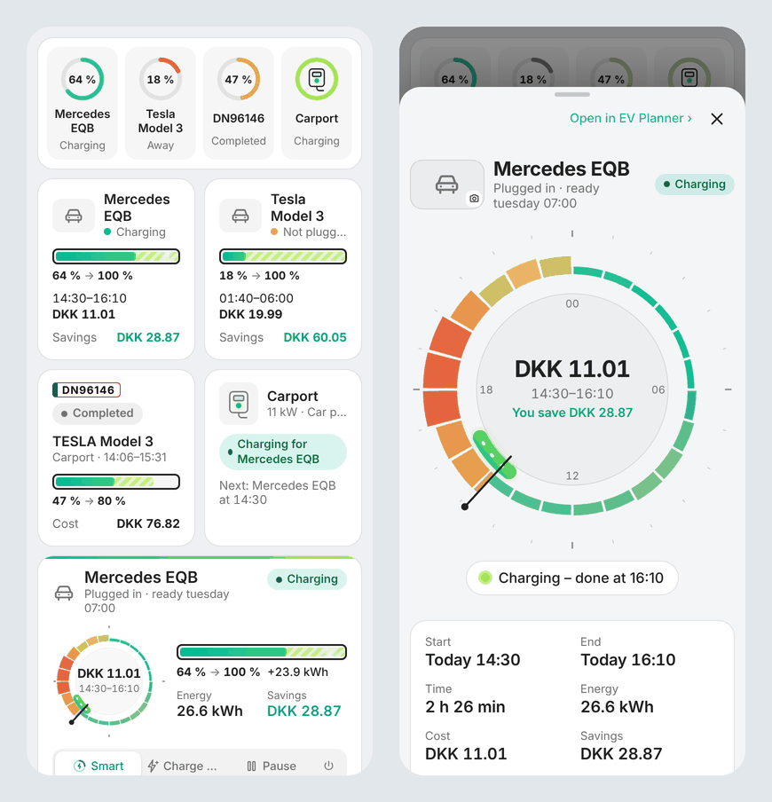
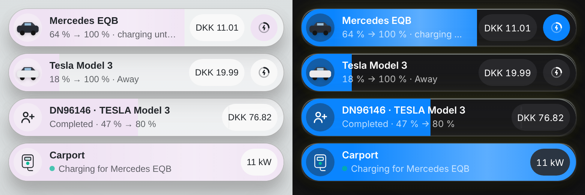

<p align="center">
  <picture>
    <source media="(prefers-color-scheme: dark)" srcset="docs/images/logo-dark.png">
    
  </picture>
</p>

<p align="center">
  <a href="https://github.com/Dinnsen/ha-ev-planner/releases"></a>
  <a href="https://hacs.xyz"></a>
  
  <a href="https://github.com/Dinnsen/ha-ev-planner/actions/workflows/tests.yml"></a>
  <a href="LICENSE"></a>
</p>

# EV Planner for Home Assistant

🇩🇰 [Læs på dansk](README.da.md)

EV Planner charges your household's electric cars when power is cheapest, and still handles the guest who arrives with an electric car. It reads the electricity prices, each car's charge level and charge limit, and when the car must be ready, and plans the cheapest charging. Then it starts and pauses the charging through the car or the charger – or, for a car neither can control, it plans, reminds and tells you.

EV Planner is built from [EV Guest](https://github.com/Dinnsen/EV-Guest) (the planner, the price clock and the guest flow) and does everything [EV Smart Charging](https://github.com/jonasbkarlsson/ev_smart_charging) does, and more.

**Contents:** [Features](#features) · [Requirements](#requirements) · [Installation](#installation) · [Setup](#setup) · [Moving from EV Smart Charging](#moving-from-ev-smart-charging) · [The panel](#the-panel) · [Dashboard cards](#dashboard-cards) · [Notifications](#notifications) · [Widgets](#widgets) · [Entities](#entities) · [Actions](#actions) · [How it works](#how-it-works) · [Limitations](#known-limitations) · [Troubleshooting](#troubleshooting) · [Removal](#removing-the-integration)

## Features

- **Any number of cars and chargers.** Cars and chargers are added on the integration's page. Cars on the same charger share it: the one that must be ready first gets it first, and a guest has it during the guest session.
- **You choose who starts and stops charging, per car:** the car (its charge switch), the charger (its switch), or neither – then EV Planner plans, reminds and publishes a *Charger control* sensor for your own automations.
- **The cheapest plan** from 15-minute or hourly prices: minute by minute, one period or the cheapest periods, with cost and savings.
- **Learns how fast each car charges.** Plans are made from the charging speed in % per hour that the car itself shows, so a car that draws less than its setting, or a battery that is not the size you expected, still gets a plan that is long enough. Nothing to set: no efficiency, no guessing.
- **Ready by** a time, per weekday, or by a trip in a calendar ("Aarhus 90 %" charges to 90 %).
- **Rules from EV Smart Charging:** minimum level whatever the price, price ceiling, charge at a low price, charge at a low battery, opportunistic charging (lower the ceiling when cheap prices are coming, or follow the last known price), earliest start, keep the charger on after the plan (precondition from the grid).
- **Finish in one go:** when charging on now, or in one period, costs at most a set amount more per kWh than the cheapest plan (e.g. 0.05), the car is charged in one go instead of stopping at dawn and finishing the next night for a few øre less. Another car plugged in on the same charger keeps the hours it has planned; a car that is not plugged in reserves nothing, since on a charger with one cable the car that is plugged in charges in its own plan.
- **Modes:** Smart, Charge now (back to Smart when full or unplugged), Pause, Off.
- **Checks that charging started:** tries once more, then tells you.
- **Plug-in reminder** with *Charge now* and *Follow the plan* buttons, **live notifications** while charging (Live Activities on iPhone, Live Updates on Android) and a **message when charged** – all with icons.
- **The guest car** exactly as in EV Guest: license plate lookup, price clock, bill and history.
- **Statistics:** energy, cost and sessions per car and month.
- **Panel** in the sidebar and as an app on the home screen, in English and Danish, light and dark.

## Requirements

- Home Assistant 2026.3 or newer (live notifications: 2026.7 or newer and the companion app).
- A price sensor with today's and tomorrow's prices, e.g. **Energi Data Service** or **Nord Pool** (as in EV Guest).
- For each car, whatever Home Assistant knows about it: charge level, charge limit, plugged in, at home, charging, and a charge switch. All are optional.

## Installation

[](https://my.home-assistant.io/redirect/hacs_repository/?owner=Dinnsen&repository=ha-ev-planner&category=integration)

1. Add `https://github.com/Dinnsen/ha-ev-planner` as a custom repository in HACS (type **Integration**), or use the button above.
2. Download **EV Planner** and restart Home Assistant.

Manually: download `ev_planner.zip` from the [latest release](https://github.com/Dinnsen/ha-ev-planner/releases) and unzip it into `config/custom_components/ev_planner`.

## Setup

[](https://my.home-assistant.io/redirect/config_flow_start/?domain=ev_planner)

1. **Settings → Devices & services → Add integration → EV Planner.** Choose the price sensor and the currency. The MotorAPI key is only for looking up guest cars by license plate.
2. On EV Planner's page, **Add charger** for each charge point. Pick its device in Home Assistant (Easee, Zaptec, Wallbox, Peblar, Ohme, OCPP, ...) and/or its brand and model: EV Planner then fills in the power, the switch, the energy meter and the *car plugged in* sensor for you to check. About 40 chargers are known, plus a wall charger, a charging post, a portable charger and a household socket.
3. **Add car** for each car:

| Setting | |
| --- | --- |
| Battery capacity | Usable capacity in kWh – or a sensor with it, for cars that report it (Wh and MWh are converted). |
| Charge level, Charge limit | The car's sensors. A *number* charge limit is also changed when you change the target in EV Planner. Without a charge level sensor you set the level yourself. |
| Plugged in, States that mean unplugged | E.g. a cable binary sensor, or a status sensor where `3` means unplugged. |
| At home, Charging | Optional. EV Planner only acts at home; *Charging* is used to check that charging started. |
| Charging power (sensor) | Optional. The car's own charging power sensor in kW (W is converted), e.g. `sensor.model3_charger_power`. EV Planner learns the power from it and counts the energy with it. |
| Charging power, Charger | What the car draws at home – a starting point until the car has shown it – and the charger it uses. |
| Who starts and stops charging | **The car** (choose its charge switch), **the charger** (the charger needs a switch), or **neither**. |
| Calendar, Keyword | Optional. Trips in the calendar set when the car must be ready. |

4. **Configure** (options): the phones and other notify actions to use, and whether to refresh iOS widgets.

## Moving from EV Smart Charging

When you add a car, EV Planner offers to start from a car in EV Smart Charging: it copies the sensors, the charge switch, the charging speed in % per hour and the settings (price ceiling, minimum level, low price, low battery, opportunistic, keep charger on, ready by, earliest start). EV Smart Charging is not changed.

Run both for a while with **who starts and stops charging** set to *neither* in EV Planner and compare the plans in the panel. Then set it to the car or the charger, turn off *Smart charging activated* in EV Smart Charging, and remove EV Smart Charging when you are happy.

## The panel

**EV Planner** in the sidebar has four tabs:

- **Cars:** a card per car with a small price clock, the charge level and target, the status and the mode. Tap a car for its page: the large price clock, the plan, the battery with handles, ready by and the weekday schedule, the rules, notifications and the next two days' prices.
- **Guest:** the guest car, as in EV Guest.
- **History:** per car and month, and the guest history with bills.
- **Settings:** billing guests, data sources, and the home-screen app (`/ev_planner_app/app.html`).

Each page has its own address, so you can link straight to it: `/ev-planner/car/<id>`, `/ev-planner/charger/<id>`, `/ev-planner/guest`, `/ev-planner/history` and `/ev-planner/settings`. A charger's page (tap its name on the overview) shows what it is doing, who is next and the cars that use it. In the home-screen app the same pages open with `app.html#car/<id>` and so on.

## Dashboard cards



EV Planner brings six cards for your own dashboards. They come with the integration – there is no resource to add and nothing to install in HACS – and are under **Add card** (search for *EV Planner*), with a visual editor where you pick the car or the charger. They use the panel's own drawing, so they look and update exactly like it.

| Card | | Size |
| --- | --- | --- |
| **Household** `custom:ev-planner-household-card` | All cars, the guest and the chargers on one line, each with its charge level and status. For a front page with little room. | Full width |
| **Car** `custom:ev-planner-car-card` | One car: battery, target, when it charges, the cost and the savings. | Half width |
| **Car, large** `custom:ev-planner-car-large-card` | The car card from EV Planner's overview: small price clock, battery and the mode buttons, which work on the card. | Full width |
| **Guest** `custom:ev-planner-guest-card` | *Add guest* when there is none, then the plate, the car, the plan and the cost, with *Stop charging* while it charges and *Bill* when it is done. | Half width |
| **Charger** `custom:ev-planner-charger-card` | One charger: what it is doing, for whom, and who is next. | Half width |
| **Bubble** `custom:ev-planner-bubble-card` | A car, the guest or a charger as one [Bubble Card](https://github.com/Clooos/Bubble-Card) button, to sit among your Bubble cards. See below. | One row |

**Tapping a card** opens a pop-up with that car's, the guest's or the charger's page: the price clock, the battery with handles, ready by, the weekly plan and the plan type for a car; everything for the guest; and the cars on a charger, which you can tap to go on. Rules and notifications stay in EV Planner – the pop-up's **Open in EV Planner** goes there. The pop-up is Home Assistant's own dialog, so it opens above everything (also from inside a Bubble Card pop-up) and closes with the back button or by pulling it down on a phone.

```yaml
type: custom:ev-planner-car-card
vehicle: 01M59TAC12D9P50SH4HK4RN1JA   # the editor fills this in
name: Tesla                           # optional
tap_action: popup                     # popup (default), panel or none
```

`tap_action: panel` opens EV Planner on that car, charger or the guest instead of the pop-up. The household card has `show_cars`, `show_guest` and `show_chargers` (all `true` by default).

### The Bubble card



The Bubble card has Bubble Card's measures (one 50 px row, round icon, name and state, sub-buttons on the right) and reads the same `--bubble-*` variables, so a theme that styles Bubble Card styles it too. Bubble Card does not have to be installed.

- **A car:** the charge level fills the button like a Bubble slider, a thin line marks the target, and a light runs through the fill while it charges. The sub-buttons are the plan's cost and the mode, which opens a menu with *Smart*, *Charge now*, *Pause* and *Off*.
- **The guest:** *Add* when there is none; then the plate, the car, the status and the levels, with *Stop* while it charges and *Bill* when it is done.
- **A charger:** whom it charges for, or who is next, and the power while it charges – then the whole button is filled, like a Bubble switch that is on.

```yaml
type: custom:ev-planner-bubble-card
vehicle: 01M59TAC12D9P50SH4HK4RN1JA   # or charger: <id>, or guest: true
```

### Themes

The cards follow your theme without card-mod:

- **Home Assistant's own variables** for the cards (`--ha-card-background`, `--ha-card-border-radius`, `--ha-card-box-shadow`, `--ha-card-border-*`) and the pop-up (`--ha-dialog-surface-background`, `--ha-dialog-border-radius`, `--ha-dialog-scrim-backdrop-filter`, `--mdc-dialog-scrim-color`).
- **Bubble Card's variables** for the Bubble card and the mode menu (`--bubble-main-background-color`, `--bubble-button-main-background-color`, `--bubble-accent-color`, `--bubble-sub-button-background-color`, `--bubble-border-radius`, `--bubble-box-shadow`, `--bubble-border`, ...), and `--bubble-pop-up-background-color` and `--bubble-pop-up-border-radius` for the pop-up, so it matches your Bubble pop-ups.
- **[Theme Studio](https://github.com/Dinnsen/theme-studio)'s variables:** the glass blur (`--theme-studio-card-backdrop-filter`) on the cards (not the Bubble card, as Bubble Card has none) and the pop-up, the raised surface (`--theme-studio-soft-background-color`) and the chip radius (`--theme-studio-chip-radius`) for the chips and icons inside the cards, and the pop-up's border and shadow (`--theme-studio-popup-border-css`, `--theme-studio-popup-shadow-css`).

Without them, the cards look as in Home Assistant's default theme.

## Notifications

Choose phones under **Configure**. Then, per car:

- **Plug-in reminder** (`switch.<car>_plug_in_reminder`): at the reminder time, when the car is home, not plugged in and below the level, with tonight's cheapest window and buttons *Charge now* and *Follow the plan*.
- **Live notification** (`switch.<car>_live_notification`): while the car charges, a Live Activity (iPhone, iOS 17.2+) or Live Update (Android) with the charge level, the target and a countdown to the end of the charging period. It ends when charging stops. iOS ends Live Activities after 8 hours and may delay frequent updates; EV Planner updates at most every 5 minutes.
- **Message when charged** (`switch.<car>_notify_when_charged`): what was charged and what it cost.
- A message when a car should charge but does not, even after one more try.

Notify actions that are not the companion app get the text only.

## Widgets

An integration cannot add widgets to a phone, but the companion app's widgets can show EV Planner:

- **iOS:** add a Home Assistant widget (*Custom*, *Gauge* or *Sensors*) and pick e.g. `sensor.<car>_summary` ("03.00-04.10 · 12,45 kr."), `sensor.<car>_status`, `sensor.<car>_plan_cost` and the car's battery level. Turn on **Refresh iOS widgets** under **Configure** to refresh them when a status changes.
- **Android:** add an *Entity* or *Template* widget with the same entities.

## Entities

Per car (e.g. `tesla`):

| Entity | |
| --- | --- |
| `select.tesla_mode` | Smart, Charge now, Pause, Off. |
| `sensor.tesla_status` | Planned, charging, waiting for prices, not plugged in, charged … Attributes: reason, deadline, calendar trip, ceiling, limited, control error. |
| `sensor.tesla_charger_control` | `charge`, `pause` or `released`, for automations (see the blueprint). |
| `binary_sensor.tesla_charge_now` | With `charging_schedule` and `raw_two_days` like EV Smart Charging, so ApexCharts cards keep working. |
| `sensor.tesla_plan_start`, `_plan_end`, `_ready_by`, `_plan_cost`, `_savings`, `_energy_needed`, `_charging_time`, `_planned_level`, `_summary` | The plan. |
| `sensor.tesla_energy_this_month`, `_cost_this_month` | Statistics. |
| `binary_sensor.tesla_charging_problem` | On when the car should charge but does not. |
| `number.tesla_target`, `_minimum_level`, `_price_ceiling`, `_low_price`, `_low_battery_level`, … | Settings. |
| `switch.tesla_ready_by`, `_price_ceiling`, `_charge_at_low_price`, `_charge_at_low_battery`, `_keep_charger_on`, `_finish_in_one_period`, … | Rules and notifications. |
| `time.tesla_ready_by`, `_earliest_start`, `_reminder_time` | Times. |

Per charger: `sensor.<charger>_charger_control` (what the charger should do, and for whom). The guest car: the EV Guest entities under the device *Guest car* (`sensor.guest_car_status`, `button.guest_car_make_plan`, …).

## Actions

- `ev_planner.set_mode` – set a car's mode (`vehicle`: the car's device, `mode`).
- `ev_planner.recalculate` – plan every car again now.
- `ev_planner.guest_lookup`, `ev_planner.guest_plan`, `ev_planner.guest_charge_now`, `ev_planner.guest_stop`, `ev_planner.new_guest` – the guest car. *Charge now* charges right away to the target, whatever the price, and is saved in the history like a plan. *Stop* ends a charge that is running: the history gets what was charged, and the charger stays paused until the guest car is unplugged (without a plugged-in sensor: until the charge would have ended).

## Photos

Tap the picture of a car (on its page) or a charger (on the overview) to add your own photo; the cross removes it. Photos are stored by Home Assistant's own image upload, shrunk on the phone first, and also shown as the picture of `sensor.<car>_status` and `sensor.<charger>_charger_control`. EV Planner ships no manufacturer photos – a charger without a photo gets a drawing of its kind.

The blueprint **EV Planner – charger follows the plan** (`blueprints/automation/ev_planner/charger_follows_plan.yaml`) starts and pauses a charger with any actions, for chargers EV Planner cannot switch itself.

## Replacing Node-RED flows and EV Smart Charging helpers

Typical flows around a car are built in, for any car and charger:

| Flow | In EV Planner |
| --- | --- |
| Tell EV Smart Charging the cable is connected (`ev_connected` switches) | Not needed: EV Planner reads the car's or charger's own *plugged in* and *at home* entities. |
| Stop the car when it starts by itself on plug-in, start it when the plan says so | *Who starts and stops charging*: **the car** (its charge switch) or **the charger**. For a few minutes after plug-in the decision is sent again. |
| Turn the switch on/off again if it did not take, and notify | Checks a few minutes after every start **and pause**, tries once more, then notifies the phones and turns on `binary_sensor.<car>_charging_problem`. A full car is not a problem. |
| 16:00: low battery, not plugged in, cheap power coming → notify | *Plug-in reminder*: time, days, level, repeat, *only at a low price* (limit and how many hours ahead), and the message has the cheapest price and time, with *Charge now* / *Follow the plan* buttons. Choose the phones per car. |
| Only act when the car is at home | The car's *at home* entity. Away – or an unknown location – EV Planner leaves charging alone. |

Cars that Home Assistant cannot start or stop (choose **neither**) still get plans, reminders, statistics and the *Charger control* sensor.

## How it works

A car without a ready-by time looks at most 24 hours ahead, and price forecasts (such as Energi Data Service's week ahead) are never used for opportunistic charging.

Every car is planned again when prices, its charge level, target, connection or settings change, and when a plan ends. A plan that is charging right now is kept until its period ends, so it never moves away under the car. Cars on the same charger are planned in order of their deadline; the periods of the first are not used by the next, and *Finish in one go* never takes the planned periods of another car that is plugged in. Each minute EV Planner decides what each car should do now – charge for a low level or a low price, follow the plan, keep the charger on, or pause – and switches only when that changes, or for a few minutes after the car is plugged in (many cars start charging by themselves). A charge you start yourself is left alone until the plan changes.

### Charging speed

The charging time comes from the charging speed in % per hour, the way EV Smart Charging plans:

1. **Before the car has shown anything:** the charging power against the battery capacity (11 kW and 77 kWh is 14.3 %/h), or the speed a car imported from EV Smart Charging had.
2. **Learned:** after a charge in which the level rose at least **30 %**, the speed it showed is learned. It is measured over the time the car actually charged, so a plan in several periods counts as one charge. A new charge moves the learned speed 30 % of the way, so one odd night does not take over.
3. **While charging:** once the charge going on has risen 30 %, the plan follows the speed it shows, so a car charged with another current is followed the same night.

A rise of 30 % or more is needed because charge levels come in steps: over a few percent, a car that reports whole percent can be far off. Changing the car's battery capacity or charging power in its setup starts learning over. The status sensor shows the speed and where it comes from (`charge_speed`, `charge_speed_source`: `estimated`, `imported`, `learned` or `measuring`, and `charge_speed_learned_from`).

The energy and cost are the charging time at the charging power – what the car draws, losses included. With the car's charging power sensor, the power is learned too (`charge_power`, `charge_power_source`), and the energy per month is counted from that sensor. Without it, the energy comes from the rising charge level, and without a charge level sensor from the charging time; the level you set yourself is then moved forward at the charging speed.

## Known limitations

- A car with neither control is only planned: it charges whenever it is plugged in unless the car itself waits.
- Prices for tomorrow usually arrive early in the afternoon; until then a plan for tomorrow morning shows *Waiting for prices*.
- Two cars on one charger with no *plugged in* sensors cannot be told apart; both are planned.
- License plate lookup is Danish (MotorAPI).

## Troubleshooting

- **No plan:** check `sensor.<car>_status` and its attributes (`plan_error`, `deadline`). *Waiting for prices* is normal before tomorrow's prices arrive.
- **The car does not start:** `binary_sensor.<car>_charging_problem` and the status attribute `control_error` say why. Check that the charge switch works in Home Assistant.
- **Download diagnostics** from the integration's page for a bug report; the license plate and API key are removed.

## Removing the integration

Remove EV Planner under **Settings → Devices & services**. Its settings, plans and history are deleted with it. Remove it from HACS and restart Home Assistant. Your cars and chargers are not changed.
